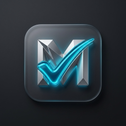
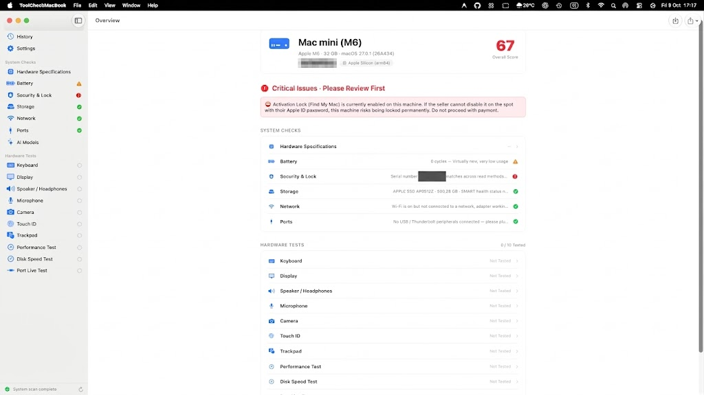

<p align="center">
  
  <h1 align="center">ToolCheckMacBook 🍏🔍</h1>
</p>

<p align="center">
  <strong>All-in-one native macOS hardware diagnostic, inspection, and verification tool.</strong><br>
  <em>Công cụ kiểm tra phần cứng, chẩn đoán và thẩm định MacBook / Mac toàn diện chạy hoàn toàn offline.</em>
</p>

<p align="center">
  <a href="https://huytran1120.github.io/ToolCheckMac/"><strong>🌐 Official Website</strong></a> •
  <a href="https://github.com/huytran1120/ToolCheckMac/releases/latest"><strong>💾 Latest Releases</strong></a> •
  <a href="#english"><strong>English</strong></a> •
  <a href="#tiếng-việt"><strong>Tiếng Việt</strong></a>
</p>

<p align="center">
  <a href="https://github.com/huytran1120/ToolCheckMac/actions/workflows/build-and-release.yml"></a>
  <a href="https://github.com/huytran1120/ToolCheckMac/releases/latest"></a>
  
  
  
  
  
  
</p>

<p align="center">
  <a href="https://github.com/huytran1120/ToolCheckMac/releases/latest/download/ToolCheckMacBook.dmg">
    
  </a>
  &nbsp;
  <a href="https://github.com/huytran1120/ToolCheckMac/releases/latest/download/ToolCheckMacBook.zip">
    
  </a>
</p>

---

<p align="center">
  
</p>

---

<a name="english"></a>
## 🌐 English

### Overview

**ToolCheckMacBook** is a native, offline macOS hardware inspection tool designed for second-hand Mac buyers, retail stores, IT technicians, and Mac enthusiasts. It provides automated detection of internal hardware, health metrics, and fraud red flags, alongside a full suite of interactive hardware diagnostics (keyboard, screen, audio, trackpad, disk speed, etc.), and exports professional PDF/PNG diagnostic reports.

### ✨ Key Features

#### 1. Automatic System & Hardware Inspection
* **Device Identification:** Resolves accurate marketing names (e.g. `MacBook Pro (14-inch, 2021)`), Apple Silicon / Intel architecture, chip variant, memory, and OS version.
* **Serial Number Anti-Tampering:** Cross-checks hardware serial numbers between IOKit kernel layer and `system_profiler` to identify spoofed identities.
* **Battery Health & Cycles:** Reads raw cycle counts, health percentage, design vs. max capacity, battery temperature, and charging status via `IOKit`.
* **Security & Lock Verification:**
  * Detects Apple DEP / MDM Enterprise management profiles.
  * Checks Apple ID sign-in status, Find My Mac, and Activation Lock risks.
  * Identifies Security Chip tier (Apple Silicon Secure Enclave, T2 Security Chip, or legacy Intel).
  * Inspects exact Apple hostname overrides in `/etc/hosts` and SIP status. Comments and unrelated hostnames are ignored; unreadable hosts files or unknown/custom SIP states remain warnings.
  * Hosts overrides and disabled SIP are investigation signals, not proof of MDM/Activation Lock bypass. Enrollment is reported independently, so one hosts finding is not counted twice.
* **Storage & NVMe SMART:** Reads SMART health, Total Bytes Written (TBW), power-on hours, unsafe shutdowns, and spare capacity.
* **Network & Connectivity:** Inspects Wi-Fi adapter state, PHY modes (Wi-Fi 6/5), Tx rate, and Bluetooth controller version.
* **Ports & Interfaces:** Detects physical USB and Thunderbolt / USB4 buses and connected peripherals.

#### 2. Interactive Hardware Diagnostics
* **Keyboard Test:** Visual keyboard matrix that lights up keys upon physical press. Detects sticky, unresponsive, or ghosting keys.
* **Display Test:** Fullscreen testing suite including pure black, pure white, RGB primaries, grayscale gradients, and checkerboards to easily spot dead/stuck pixels and backlight bleeding.
* **Speaker & Headphones:** Plays stereo sweeps through isolated Left and Right audio channels.
* **Microphone Test:** Live RMS input level visualizer to verify microphone sensitivity without recording or saving audio.
* **Camera Test:** Live camera preview to verify webcam sensor clarity and spot lens defects.
* **Touch ID Test:** Prompts biometric authentication via `LocalAuthentication` to confirm sensor functionality.
* **Trackpad Test:** Canvas drawing with gesture recognition (multi-finger pan, pinch, rotate) and Force Touch pressure gauge.
* **Disk Speed Benchmark:** Real-time read/write performance testing bypassing OS cache (`F_NOCACHE`), measuring genuine SSD throughput (MB/s).
* **Performance Stress Test:** Multi-core CPU stress benchmark monitoring real-time thermal throttling states (`Nominal`, `Fair`, `Serious`, `Critical`).
* **Live Port Plug/Unplug Test:** Live USB tree differential detection to verify each physical port as devices are inserted or removed.

#### 3. AI Model Advisor
* Analyzes unified memory capacity and recommends suitability for local Open-Weight LLMs (Llama 3, DeepSeek, Qwen 2.5, Mistral, Gemma 2, Phi).
* Classifies model runnable tiers: *Runs Smoothly*, *Runnable*, *Barely Runnable*, or *Not Recommended*.

#### 4. Reports & History Management
* **Overall Scoring:** Calculates a weighted 0–100 score, immediately isolating critical **⛔ Red Flag Issues** (MDM enrollment, Activation Lock, serial mismatch).
* **Export Reports:** Generates standalone high-resolution PNG snapshots or long-page PDFs with branded 3D logo, including bilingual MDM verification advisories.
* **History Comparison:** Automatically stores local snapshots to track wear and compare performance over time.

Offline checks cannot certify release from an organization. Before transfer, obtain the owner's consent and back up data before any erase/setup procedure. [Erase All Content and Settings](https://support.apple.com/en-us/102664) requires Apple Silicon or Intel with T2; other Intel Macs need Apple's macOS Recovery erase/reinstall procedure. Resetting the Mac does not itself remove organizational registration.

#### 5. In-App Bilingual Support (VI 🇻🇳 / EN 🇬🇧)
* **Instant Dynamic Switching:** Toggle between **Tiếng Việt 🇻🇳** and **English 🇬🇧** in Settings with zero latency — no app restart needed.
* **Domain-Specific Translations:** Clear technical explanations for second-hand device buyers and technicians regarding hardware alerts and risks.
* **Localized Report Exports:** Exported PNG receipts and PDF diagnostic documents render automatically in your selected language.

#### 6. 1-Click AppleCare Quick Lookup & Copy Serial
* **1-Click AppleCare Lookup:** Click `[ 🔍 Check AppleCare ↗ ]` next to the Serial Number to automatically copy the serial to clipboard and open Apple's official [checkcoverage.apple.com](https://checkcoverage.apple.com/) portal in your browser. Eliminates manual typing and character confusion (`0` vs `O`, `1` vs `I`).
* **1-Click Copy Serial Button:** Dedicated `[ 📋 Copy ]` button with real-time `✓ Copied!` visual feedback on both the Overview dashboard and Hardware Specifications panel.

---

### 🔒 Privacy & Security Pledge

1. **100% Offline:** The app contains zero network networking code (`URLSession`, sockets, telemetry, or remote tracking). No data ever leaves your device.
2. **Read-Only System Commands:** Gathers hardware data using standard macOS system tools (`system_profiler`, `ioreg`, `profiles status`, `defaults read`).
3. **No Root / Sudo Required:** Runs safely under standard user permissions without asking for root access or installing background daemons.
4. **Safe Testing:** Disk benchmarks create a temporary test file that is deleted immediately upon completion. Camera and microphone tests never write audio/video to disk.

---

### 💻 System Requirements

* **Operating System:** macOS 14.0 (Sonoma) or later
* **Hardware:** Apple Silicon or Intel Mac
* **Xcode:** Xcode 16.0+ (if compiling from source)
---

### 📥 Installation

#### Option 1: Direct DMG Download (Recommended)
1. Download **[ToolCheckMacBook.dmg](https://github.com/huytran1120/ToolCheckMac/releases/latest/download/ToolCheckMacBook.dmg)** from the latest release.
2. Open the `.dmg` disk image and drag **ToolCheckMacBook.app** into your `/Applications` folder.

> **💡 First-Time Launch Guide (macOS Gatekeeper):**  
> Because ToolCheckMacBook is an open-source tool built via GitHub Actions and not signed with a paid Apple Developer certificate, macOS Gatekeeper may show a warning: *"ToolCheckMacBook cannot be opened because Apple cannot check it for malicious software"* or *"Unidentified Developer"*.  
> To open the app safely using official [Apple guidance](https://support.apple.com/102445):
> - **Method 1 (Quickest):** In Finder, open your **Applications** folder, **Right-click** (or hold **`Control`** and click) **ToolCheckMacBook** › choose **Open** › click **Open** on the confirmation dialog.
> - **Method 2:** Go to **Apple Menu  › System Settings › Privacy & Security**, scroll down to the **Security** section, and click **Open Anyway**.
> - **Permissions:** When prompted, allow Camera and Microphone permissions so interactive hardware tests can verify sensor functionality.

Verify download integrity (Optional):
```bash
shasum -a 256 ToolCheckMacBook.dmg
# Release assets provide automatic SHA-256 checksums on the GitHub Releases page
```

#### Option 2: Homebrew Cask
```bash
brew install --cask https://raw.githubusercontent.com/huytran1120/ToolCheckMac/main/Casks/toolcheckmacbook.rb
```

---

### 🛠️ Building from Source

```bash
# 1. Clone repository
git clone https://github.com/huytran1120/ToolCheckMac.git
cd ToolCheckMac

# 2. (Optional) Regenerate Xcode project with XcodeGen
brew install xcodegen
xcodegen generate

# 3. Build Universal Release binary (Apple Silicon + Intel)
xcodebuild \
  -project ToolCheckMacBook.xcodeproj \
  -scheme ToolCheckMacBook \
  -configuration Release \
  -destination "generic/platform=macOS" \
  -derivedDataPath ./build \
  CODE_SIGN_IDENTITY="-" \
  CODE_SIGNING_REQUIRED=NO
```

The compiled application bundle will be located at:
```text
build/Build/Products/Release/ToolCheckMacBook.app
```

To run the application:
```bash
open ./build/Build/Products/Release/ToolCheckMacBook.app
```

---

### 🧪 Running Automated Unit Tests

The automated unit tests cover localization and diagnostic meaning, incomplete SMART/serial evidence, report scoring and battery warning propagation, subprocess output and timeouts, benchmark cancellation and I/O failures, keyboard shortcuts, history persistence, and PNG/PDF rendering. See [the testing checklist](docs/TESTING.md) for regression scenarios and physical hardware verification.

```bash
# Run all tests via helper script:
./scripts/run_tests.sh

# Or directly with xcodebuild:
xcodebuild test -project ToolCheckMacBook.xcodeproj -scheme ToolCheckMacBook -destination "platform=macOS" CODE_SIGN_IDENTITY="-" CODE_SIGNING_REQUIRED=NO
```

---

### 📦 Packaging DMG

A build and packaging script is included:

```bash
./scripts/build_and_notarize.sh
```

Output file:
```text
~/Desktop/ToolCheckMacBook-1.3.3.dmg
```

For official Developer ID signing and Apple notarization, configure environment variables prior to running the script:
```bash
export TOOLCHECKMACBOOK_SIGN_ID="Developer ID Application: Your Name (TEAMID)"
export TOOLCHECKMACBOOK_NOTARY_PROFILE="toolcheckmacbook-notary"
./scripts/build_and_notarize.sh
```

---

### ❓ Troubleshooting

* **macOS Gatekeeper Warning ("App is damaged" or "Unidentified Developer"):**
  CI downloads are not Developer ID signed or notarized. Do not bypass damaged-app or malware warnings, disable Gatekeeper, or remove quarantine attributes. See [Apple's guidance](https://support.apple.com/102445); use a verified signed distribution or build from reviewed source instead.

* **Permission Prompts:**
  When testing the Camera, Microphone, or Bluetooth, macOS will ask for permission. If denied, enable them manually in **System Settings › Privacy & Security**.

---

### 📋 Release History & Changelog

* **v1.3.3** (Build 7) - *Current*
  * **Critical Concurrency Fix:** Replaced legacy completion handlers with Swift async/await (`await AVCaptureDevice.requestAccess`) in Microphone and Camera tests, resolving `EXC_BREAKPOINT` / `SIGTRAP` crash on macOS 15+ Sequoia.
  * **First-Time Launch Guide:** Added explicit step-by-step Gatekeeper instructions (Control-Click / Open Anyway) in documentation and GitHub Pages.
* **v1.3.2** (Build 6)
  * **MDM evidence:** Exact hostname parsing with IPv4/IPv6 support, explicit hosts read errors, and independent enrollment results without duplicate score deductions.
  * **SIP and localization:** Preserves enabled, disabled, and unknown/custom states; bilingual warnings describe evidence without claiming certain bypass.
  * **Complete reports:** Includes MDM advisories in PNG/PDF, with consent, backup, and Intel-without-T2 guidance.
  * **Regression coverage:** 92 automated tests, including scanner fixtures, scoring, legacy data, and bilingual report content.
* **v1.3.1** (Build 5)
  * **Diagnostic reliability:** Battery mismatch warnings reach reports; missing SMART or incomplete serial verification remains a warning.
  * **Safe benchmarks and commands:** Cooperative cancellation, complete-I/O validation, command timeouts, and actual elapsed CPU stress duration.
  * **Correct feedback:** Fixed Command key coverage and T2/MDM translations; history and export failures are visible without discarding existing data.
  * **Regression coverage:** 67 automated tests covering diagnostics, benchmarks, localization, history, and report export.
  * **Release packaging:** Validates both Universal 2 architectures and keeps downloadable filenames consistent with the app version.
* **v1.3.0** (Build 4) - *Development version; no public release*
  * 🌐 **Bilingual In-App Support:** Seamless zero-latency switching between Tiếng Việt 🇻🇳 and English 🇬🇧 without restart.
  * 🔍 **1-Click AppleCare Quick Lookup:** Instant copy of Serial Number and direct opening of official Apple coverage portal.
  * 📋 **1-Click Copy Serial Button:** Dedicated copy button with real-time `✓ Copied!` visual indicator.
  * 🎨 **Official 3D App Icon:** High-resolution multi-scale app icon and branded header on exported reports.
* **v1.2.0** (Build 3)
  * Comprehensive interactive test suite (Screen dead pixels, keyboard matrix, sound/mic, camera).
  * High-resolution PNG and PDF diagnostic report exports.
* **v1.0.0** (Build 1)
  * Initial release: 100% offline hardware scanning, battery health, MDM/DEP & iCloud lock detection, SSD benchmark.

---

### 📄 License

This project is licensed under the MIT License - see the [LICENSE](LICENSE) file for details.

---

<br>
<hr>
<br>

<a name="tiếng-việt"></a>
## 🇻🇳 Tiếng Việt

### Giới thiệu tổng quan

**ToolCheckMacBook** là ứng dụng macOS chuyên dụng, hỗ trợ kiểm tra và thẩm định toàn diện phần cứng máy tính Mac. Ứng dụng đặc biệt hữu ích khi mua bán MacBook cũ, kiểm tra tại cửa hàng hoặc bảo trì máy định kỳ. Toàn bộ quá trình quét và kiểm tra diễn ra **100% offline**, tự động đọc thông số cấu hình, cảnh báo rủi ro máy dính quản lý/khoá từ xa, cung cấp bộ bài test phần cứng trực quan và xuất báo cáo PDF / PNG chi tiết.

### ✨ Các tính năng nổi bật

#### 1. Tự động phát hiện cấu hình & Rủi ro phần cứng
* **Nhận diện chính xác tên máy:** Tự động lấy tên thương mại chuẩn (ví dụ: `MacBook Pro (14-inch, 2021)`), đời máy, vi xử lý, RAM và phiên bản macOS.
* **Chống làm giả số sê-ri:** Đối soát số sê-ri đọc từ tầng nhân IOKit và `system_profiler` để cảnh báo nếu máy bị can thiệp làm giả thông tin.
* **Kiểm tra pin chuyên sâu:** Đọc số chu kỳ sạc (Cycle Count), tỷ lệ sức khoẻ (Battery Health %), dung lượng thiết kế, dung lượng tối đa hiện tại, nhiệt độ pin và công suất sạc.
* **Cảnh báo MDM & Khoá iCloud:**
  * Quét hồ sơ quản lý từ xa MDM / DEP của doanh nghiệp.
  * Kiểm tra tình trạng đăng nhập Apple ID, Find My Mac và nguy cơ dính Activation Lock (Khoá kích hoạt).
  * Xác định phân loại chip bảo mật (Apple Silicon Secure Enclave, Intel chip T2 hoặc Intel đời cũ).
  * Kiểm tra ánh xạ đúng tên miền Apple trong `/etc/hosts` và trạng thái SIP. Bỏ qua comment/tên miền không liên quan; không đọc được hosts hoặc SIP chưa xác định/cấu hình tùy chỉnh sẽ báo cảnh báo.
  * Ánh xạ hosts và SIP bị tắt là dấu hiệu cần xác minh, không chứng minh bypass MDM/Activation Lock. Kết quả enrollment tách biệt để không trừ điểm hai lần cho cùng một phát hiện hosts.
* **Sức khoẻ ổ cứng (NVMe SMART):** Đọc tình trạng SMART, tổng lượng ghi dữ liệu (TBW), số giờ hoạt động, số lần tắt nguồn đột ngột và dung lượng dự phòng.
* **Mạng & Bluetooth:** Kiểm tra card Wi-Fi, chuẩn kết nối (Wi-Fi 6/5), tốc độ Tx rate và phiên bản chip Bluetooth.
* **Cổng kết nối:** Liệt kê các cổng USB vật lý, controller Thunderbolt / USB4 và thiết bị ngoại vi đang gắn.

#### 2. Bộ công cụ kiểm tra phần cứng tương tác
* **Kiểm tra bàn phím:** Giao diện bàn phím trực quan, phím sáng đèn ngay khi nhấn. Phát hiện tức thì các phím liệt, kẹt phím hoặc chập phím.
* **Kiểm tra màn hình:** Chế độ toàn màn hình lần lượt hiển thị màu Đen tuyệt đối, Trắng tinh, Đỏ, Xanh lá, Xanh dương, dải xám gradient và caro để phát hiện điểm chết (dead/stuck pixels) và hở sáng (backlight bleed).
* **Loa & Tai nghe:** Phát âm thanh quét tần số độc lập cho từng kênh Trái (Left) và Phải (Right).
* **Microphone:** Hiển thị thanh đo cường độ âm thanh tức thời (RMS level) khi bạn nói vào mic; hoàn toàn không lưu hay ghi âm giọng nói.
* **Camera:** Khởi động preview hình ảnh trực tiếp từ webcam để kiểm tra độ sắc nét, bụi ống kính hoặc lỗi cảm biến.
* **Touch ID:** Gọi xác thực sinh trắc học qua LocalAuthentication để kiểm tra độ nhạy của cảm biến vân tay.
* **Trackpad:** Bảng vẽ theo dõi di chuột, kiểm tra thao tác đa ngón (cuộn, phóng to, xoay) và đo lực nhấn Force Touch.
* **Đo tốc độ ổ cứng (Disk Speed Test):** Kiểm tra tốc độ đọc/ghi tuần tự thực tế (MB/s) bằng cơ chế Direct I/O (`F_NOCACHE`), bỏ qua bộ nhớ đệm RAM.
* **Stress Test hiệu năng & Tản nhiệt:** Chạy tải nặng đa nhân CPU trong thời gian ngắn và theo dõi trạng thái nhiệt độ hệ thống (`Nominal`, `Fair`, `Serious`, `Critical`).
* **Test cắm/rút cổng kết nối (Port Live Check):** Nhận diện trực tiếp sự kiện cắm hoặc rút thiết bị USB vào từng cổng để kiểm tra độ ổn định của chân cắm.

#### 3. Tư vấn mô hình AI cục bộ (AI Model Advisor)
* Dựa trên dung lượng bộ nhớ hợp nhất (Unified Memory) của máy, hệ thống tư vấn khả năng chạy các mô hình ngôn ngữ lớn (LLM mã nguồn mở như Llama 3, DeepSeek, Qwen 2.5, Mistral, Gemma 2, Phi).
* Đánh giá trực quan: *Chạy mượt (Runs Smoothly)*, *Chạy được (Runnable)*, *Vừa đủ (Barely Runnable)*, hoặc *Không khuyến nghị (Not Recommended)*.

#### 4. Xuất báo cáo & Lịch sử kiểm tra
* **Thang điểm tổng quát:** Tính điểm tổng hợp (0–100 điểm) và gom các lỗi nghiêm trọng vào khu vực **⛔ Red Flag Issues** (máy dính MDM, dính khoá kích hoạt, sai số sê-ri).
* **Xuất báo cáo 1 chạm:** Xuất kết quả thành ảnh PNG chất lượng cao hoặc PDF dài một trang có Logo 3D, kèm lưu ý xác minh MDM bằng cả tiếng Việt và tiếng Anh.
* **So sánh lịch sử:** Tự động lưu bản ghi chẩn đoán vào bộ nhớ máy để tiện theo dõi độ hao mòn pin và hiệu năng giữa các lần kiểm tra.

Kiểm tra ngoại tuyến không chứng minh máy đã được gỡ khỏi tổ chức. Chỉ xóa/thiết lập lại máy sau khi chủ sở hữu đồng ý và đã sao lưu. [Erase All Content and Settings](https://support.apple.com/en-us/102664) yêu cầu Apple Silicon hoặc Intel có T2; Intel không có T2 cần quy trình xóa/cài lại qua macOS Recovery của Apple. Đặt lại máy không tự gỡ đăng ký tổ chức.

#### 5. Hỗ trợ Song ngữ In-App (Tiếng Việt 🇻🇳 / English 🇬🇧)
* **Chuyển đổi tức thì 1-Click:** Chuyển đổi ngôn ngữ hiển thị giữa **Tiếng Việt 🇻🇳** và **English 🇬🇧** trực tiếp trong mục Cài đặt (Settings) với 0 giây chờ đợi, không cần khởi động lại app.
* **Bản dịch kỹ thuật chuẩn xác:** Các thuật ngữ phần cứng, giải thích cờ đỏ MDM/iCloud, hướng dẫn các bài test được bản địa hoá tự nhiên, dễ hiểu cho cả thợ kỹ thuật và người dùng phổ thông.
* **Biên bản báo cáo đa ngôn ngữ:** Ảnh PNG và file PDF xuất ra sẽ hiển thị hoàn toàn theo ngôn ngữ bạn đang chọn.

#### 6. Tra cứu AppleCare & Nút Sao chép Serial 1-Click
* **Nút Tra cứu AppleCare (`[🔍 Tra cứu AppleCare ↗]`):** Tự động sao chép số Serial vào clipboard và mở ngay trang tra cứu bảo hành chính thức [checkcoverage.apple.com](https://checkcoverage.apple.com/) trên trình duyệt, xoá bỏ hoàn toàn rủi ro gõ nhầm ký tự (`0` với `O`, `1` với `I`).
* **Nút Sao chép Serial riêng biệt (`[📋 Sao chép]`):** Đặt cạnh số Serial ở trang Tổng quan và trang Thông số máy, phản hồi thị giác màu xanh `✓ Đã sao chép!` tức thì để copy nhanh gửi khách hoặc thợ.

---

### 🔒 Cam kết An toàn & Quyền riêng tư

1. **Hoạt động 100% Offline:** Không có bất kỳ dòng code nào gửi dữ liệu qua mạng (`URLSession`, socket, telemetry,...). Không thu thập số sê-ri hay cấu hình máy của người dùng.
2. **Lệnh hệ thống an toàn (Read-Only):** Ứng dụng chỉ sử dụng các công cụ chuẩn có sẵn của macOS để đọc thông tin phần cứng (`system_profiler`, `ioreg`, `profiles status`, `defaults read`).
3. **Không cần quyền Root / Sudo:** Chạy an toàn với quyền người dùng thông thường, không can thiệp file hệ thống và không cài tiến trình ngầm (Daemon/Agent).
4. **Quy trình test sạch:** File test tốc độ ổ cứng được tự động dọn sạch ngay sau khi đo xong. Bài test camera và micro không lưu lại bất kỳ hình ảnh hay âm thanh nào vào ổ cứng.

---

### 💻 Yêu cầu hệ thống

* **Hệ điều hành:** macOS 14.0 (Sonoma) trở lên
* **Phần cứng:** Apple Silicon hoặc Mac chạy chip Intel
* **Môi trường phát triển:** Xcode 16.0+ (nếu muốn build từ mã nguồn)

---

### 📥 Hướng dẫn Cài đặt & Sử dụng

#### Cách 1: Tải trực tiếp file .DMG (Khuyên dùng)
1. Tải bản mới nhất **[ToolCheckMacBook.dmg](https://github.com/huytran1120/ToolCheckMac/releases/latest/download/ToolCheckMacBook.dmg)** từ mục Releases.
2. Mở file `.dmg` và kéo biểu tượng **ToolCheckMacBook.app** vào thư mục `Applications`.

> **💡 Hướng dẫn mở ứng dụng lần đầu cho người mới (Vượt cảnh báo Gatekeeper):**  
> Vì **ToolCheckMacBook** là phần mềm mã nguồn mở miễn phí chưa mua chứng chỉ trả phí Apple Developer ($99/năm), macOS sẽ hiển thị cảnh báo: *"Không thể mở ứng dụng vì Apple không thể kiểm tra phần mềm độc hại"* hoặc *"Nhà phát triển chưa được xác minh"*.  
> Để mở ứng dụng an toàn theo đúng [hướng dẫn chính thức của Apple](https://support.apple.com/102445):
> - **Cách 1 (Nhanh nhất • 3 giây):** Vào thư mục **Applications (Ứng dụng)** trong Finder, **nhấp chuột phải** (hoặc giữ phím **`Control`** + click) vào **ToolCheckMacBook** › chọn **Mở (Open)** › bấm tiếp nút **Mở (Open)** ở hộp thoại xác nhận.
> - **Cách 2:** Mở **Cài đặt hệ thống (System Settings) › Quyền riêng tư & Bảo mật (Privacy & Security)** › cuộn xuống mục **Bảo mật** › bấm nút **Vẫn mở (Open Anyway)**.
> - **Cấp quyền kiểm tra phần cứng:** Khi chạy bài test Webcam hoặc Microphone lần đầu, hãy bấm **OK / Cho phép** để ứng dụng có thể kiểm tra tín hiệu cảm biến.

Kiểm tra tính toàn vẹn (Checksum SHA-256):
```bash
shasum -a 256 ToolCheckMacBook.dmg
# Mã băm SHA-256 được đính kèm tự động trong phần tài sản phát hành trên GitHub Releases
```

#### Cách 2: Cài đặt nhanh qua Homebrew Cask
```bash
brew install --cask https://raw.githubusercontent.com/huytran1120/ToolCheckMac/main/Casks/toolcheckmacbook.rb
```

---

### 🛠️ Hướng dẫn Build từ mã nguồn

```bash
# 1. Clone repository về máy
git clone https://github.com/huytran1120/ToolCheckMac.git
cd ToolCheckMac

# 2. (Tuỳ chọn) Tạo file project Xcode bằng XcodeGen
brew install xcodegen
xcodegen generate

# 3. Build bản Universal Release (chạy mượt trên cả Apple Silicon & Intel)
xcodebuild \
  -project ToolCheckMacBook.xcodeproj \
  -scheme ToolCheckMacBook \
  -configuration Release \
  -destination "generic/platform=macOS" \
  -derivedDataPath ./build \
  CODE_SIGN_IDENTITY="-" \
  CODE_SIGNING_REQUIRED=NO
```

File ứng dụng sau khi build nằm tại:
```text
build/Build/Products/Release/ToolCheckMacBook.app
```

Khởi chạy ứng dụng:
```bash
open ./build/Build/Products/Release/ToolCheckMacBook.app
```

---

### 🧪 Chạy Bộ Kiểm Thử Tự Động (Unit Tests)

Bộ kiểm thử tự động (Unit Tests) bao phủ ý nghĩa chẩn đoán song ngữ, dữ liệu SMART/serial chưa đầy đủ, tính điểm và cảnh báo pin, lệnh hệ thống quá hạn, hủy benchmark và lỗi I/O, phím tắt bàn phím, lưu lịch sử và kết xuất PNG/PDF. Xem [danh sách kiểm tra](docs/TESTING.md) để biết các trường hợp hồi quy và kiểm chứng phần cứng thực tế.

```bash
# Chạy toàn bộ test bằng script rút gọn:
./scripts/run_tests.sh

# Hoặc chạy trực tiếp bằng xcodebuild:
xcodebuild test -project ToolCheckMacBook.xcodeproj -scheme ToolCheckMacBook -destination "platform=macOS" CODE_SIGN_IDENTITY="-" CODE_SIGNING_REQUIRED=NO
```

---

### 📦 Đóng gói file cài đặt DMG

Dự án có sẵn script đóng gói tự động:

```bash
./scripts/build_and_notarize.sh
```

File cài đặt đầu ra:
```text
~/Desktop/ToolCheckMacBook-1.3.3.dmg
```

Nếu bạn có tài khoản Apple Developer và muốn ký chứng chỉ Developer ID + công chứng (Notarization) để phân phối rộng rãi:
```bash
export TOOLCHECKMACBOOK_SIGN_ID="Developer ID Application: Your Name (TEAMID)"
export TOOLCHECKMACBOOK_NOTARY_PROFILE="toolcheckmacbook-notary"
./scripts/build_and_notarize.sh
```

---

### ❓ Xử lý sự cố thường gặp

* **macOS cảnh báo "App is damaged" hoặc "Nhà phát triển chưa được xác minh":**
  Bản CI chưa được ký Developer ID hoặc công chứng. Không bỏ qua cảnh báo ứng dụng hỏng hay mã độc, không tắt Gatekeeper hoặc gỡ thuộc tính cách ly. Xem [hướng dẫn của Apple](https://support.apple.com/102445); sử dụng bản phân phối đã ký và xác minh hoặc tự build từ mã nguồn đã kiểm tra.

* **Cấp quyền Camera / Micro / Bluetooth:**
  Trong lần đầu chạy các bài test tương tác, macOS sẽ hiển thị hộp thoại xin cấp quyền. Nếu vô tình bấm Từ chối, bạn có thể cấp lại quyền tại: **Cài đặt hệ thống (System Settings) › Quyền riêng tư & Bảo mật (Privacy & Security)**.

---

### 📋 Lịch sử phiên bản (Changelog)

* **v1.3.3** (Build 7) - *Mới nhất*
  * **Sửa lỗi văng app nghiêm trọng (Concurrency Crash):** Chuyển toàn bộ cơ chế xin quyền Camera và Microphone sang chuẩn `async/await` hiện đại của Swift 6, khắc phục triệt để lỗi xung đột luồng `MainActor` (`EXC_BREAKPOINT / SIGTRAP`) trên macOS 15+ Sequoia.
  * **Hướng dẫn vượt Gatekeeper cho người mới:** Bổ sung hướng dẫn chi tiết cách mở ứng dụng lần đầu (Chuột phải / Control+Click hoặc bấm Vẫn mở trong Cài đặt).
* **v1.3.2** (Build 6)
  * **Bằng chứng MDM:** Phân tích đúng hostname và IPv4/IPv6, thông báo lỗi đọc hosts, tách enrollment để không trừ điểm hai lần.
  * **SIP và bản dịch:** Giữ đúng trạng thái bật, tắt, chưa xác định/cấu hình tùy chỉnh; cảnh báo song ngữ không khẳng định chắc chắn bypass.
  * **Báo cáo đầy đủ:** PNG/PDF có lưu ý MDM, yêu cầu đồng ý/sao lưu và hướng dẫn dành cho Intel không có T2.
  * **Kiểm thử hồi quy:** 92 test tự động, bao gồm dữ liệu quét giả lập, tính điểm, dữ liệu cũ và nội dung báo cáo song ngữ.
* **v1.3.1** (Build 5)
  * **Chẩn đoán đáng tin cậy hơn:** Cảnh báo pin xuất hiện trong báo cáo; SMART thiếu dữ liệu hoặc serial chưa đối chiếu được không báo đạt.
  * **Benchmark và lệnh hệ thống an toàn hơn:** Hủy tác vụ nền, kiểm tra đủ dữ liệu I/O, giới hạn thời gian chạy lệnh và đo thời gian stress CPU thực tế.
  * **Phản hồi chính xác:** Ghi nhận phím Command, sửa bản dịch T2/MDM; hiển thị lỗi lịch sử và xuất báo cáo, bảo vệ dữ liệu hiện có.
  * **Kiểm thử hồi quy:** 67 test tự động cho chẩn đoán, benchmark, bản dịch, lịch sử và xuất báo cáo.
  * **Đóng gói phát hành:** Kiểm tra đủ hai kiến trúc Universal 2 và đồng bộ tên file tải với phiên bản ứng dụng.
* **v1.3.0** (Build 4) - *Bản phát triển; chưa phát hành công khai*
  * 🌐 **Hỗ trợ Song ngữ In-App:** Chuyển đổi mượt mà giữa Tiếng Việt 🇻🇳 và English 🇬🇧 không cần khởi động lại.
  * 🔍 **Tra cứu nhanh AppleCare 1-Click:** Tự động copy số Serial và mở trực tiếp trang tra cứu bảo hành Apple.
  * 📋 **Nút Sao chép Serial tiện lợi:** Nút sao chép 1 chạm với thông báo thị giác phản hồi `✓ Đã sao chép!` tức thì.
  * 🎨 **Biểu tượng App Icon 3D chính thức:** Bộ icon đa độ phân giải phong cách macOS hiện đại cùng nhận diện thương hiệu trên báo cáo.
* **v1.2.0** (Build 3)
  * Bộ bài kiểm tra tương tác toàn diện (Điểm chết màn hình, ma trận phím, loa, mic, camera).
  * Xuất báo cáo biên bản dạng ảnh PNG và tệp PDF chất lượng cao.
* **v1.0.0** (Build 1)
  * Bản phát hành đầu tiên: Kiểm tra phần cứng offline, chẩn đoán pin, phát hiện MDM/iCloud ẩn và đo tốc độ SSD.

---

### ⚖️ Tuyên bố từ chối trách nhiệm (Disclaimer)

- **ToolCheckMacBook** là công cụ hỗ trợ người dùng tự kiểm tra phần cứng, không thay thế cho kết quả thẩm định kỹ thuật chính thức từ các trung tâm bảo hành ủy quyền của Apple.
- Một số thông tin phụ thuộc máy chủ Apple (như hạn bảo hành chính hãng AppleCare) cần được kiểm tra trực tiếp trên trang web tra cứu chính thức của Apple.

---

### 📄 Giấy phép (License)

Dự án được phân phối theo giấy phép mã nguồn mở **MIT License** - xem chi tiết tại file [LICENSE](LICENSE).
